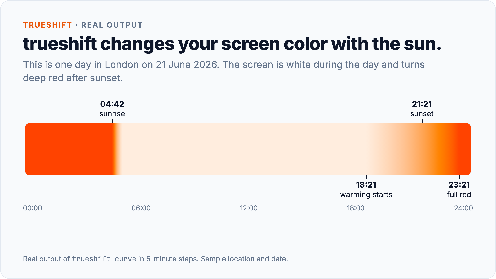
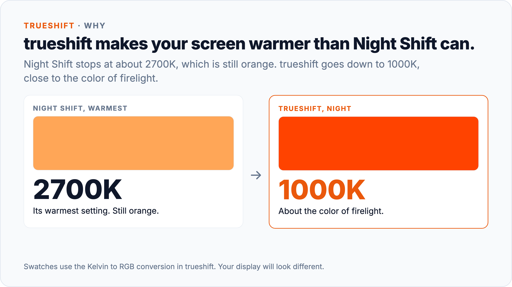
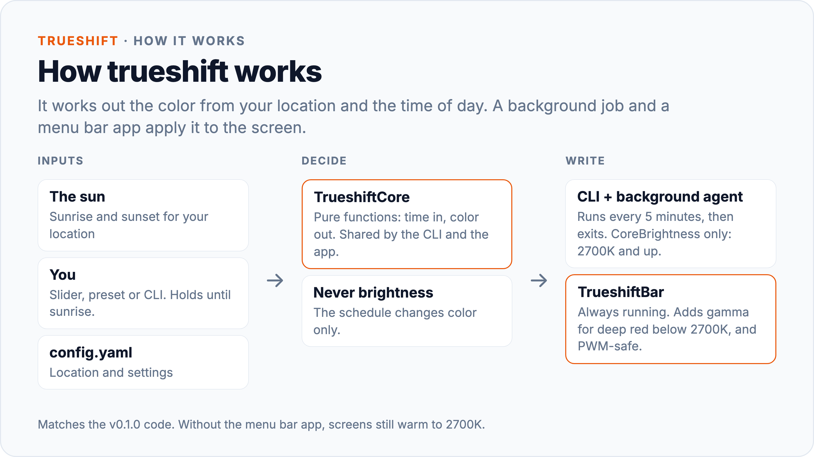
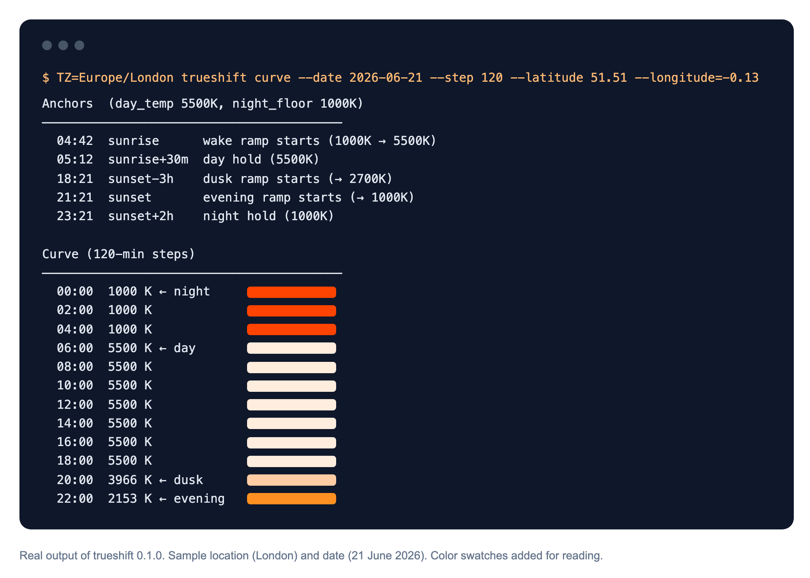

# trueshift

trueshift changes your Mac's screen color with the sun. The screen is white during the day and turns deep red after sunset.

trueshift is a command line tool and menu bar app for macOS. It sets your screen color from the real sunrise and sunset at your location. After dark it goes down to about 1000K, close to firelight, at full brightness. It runs in the background.



## Why not Night Shift or f.lux?



- **Deep red, not orange.** trueshift goes down to 1000K. Night Shift stops at about 2700K.
- **It follows your sun.** The red arrives with your real sunset, so it moves with the seasons.
- **Red, not dark.** The schedule changes color only. It never changes brightness.
- **No flicker (optional).** PWM-safe mode holds the backlight at 100% and dims the image in software.
- **Your choice wins.** A manual change holds until the next sunrise. Then the schedule takes over again.
- **Small and open.** Under 3,000 lines of Swift and Objective-C. No network code.



## Install

You need macOS 14 (Sonoma) or later and Swift 5.9 or later (Xcode or the Command Line Tools).

```bash
git clone https://github.com/AaqifZ/trueshift.git && cd trueshift
swift build -c release
sudo install -d /usr/local/bin && sudo install .build/release/trueshift /usr/local/bin/
```

The `sudo` step copies one file to `/usr/local/bin`. trueshift itself runs without admin rights.

### Set up

1. Create the config file:
   ```bash
   trueshift status
   ```
2. Edit `~/.config/trueshift/config.yaml` and put in your own location. The default is Sydney.
   ```yaml
   location:
     latitude: -33.87    # your latitude
     longitude: 151.21   # your longitude
   ```
3. Install the background agent. It applies the schedule every 5 minutes:
   ```bash
   trueshift install
   ```
4. Install the menu bar app. You need it for deep red below 2700K and for PWM-safe mode:
   ```bash
   scripts/bundle-app.sh
   open /Applications/TrueshiftBar.app
   ```

## Use

```bash
trueshift status            # current color, phase and mode
trueshift status --json     # the same, for scripts
trueshift set 1000          # set a color now; holds until the next sunrise
trueshift off               # filter off until the next sunrise
trueshift resume            # return to the automatic schedule
trueshift pwm on            # PWM-safe mode on (applied by the menu bar app)
trueshift dim 60            # software brightness for PWM-safe mode (20-100)
trueshift uninstall         # remove the background agent
trueshift curve --date 2026-06-21   # print one day's schedule
```

The menu bar app has the same controls: presets, a color slider, and Resume Auto.

### The schedule

| Phase | When | Color |
|---|---|---|
| Wake | sunrise to sunrise + 30 min | 1000K to 5500K |
| Day | until sunset - 3 h | 5500K |
| Dusk | sunset - 3 h to sunset | 5500K to 2700K |
| Evening | sunset to sunset + 2 h | 2700K to 1000K |
| Night | until sunrise | 1000K |

Optional settings in `config.yaml`:

```yaml
schedule:
  day_temp: 5500      # daytime color
  night_floor: 1000   # night color
  deep_red: true      # false = stop at 2700K
```

## How it works

macOS gives two ways to change screen color:
- **CoreBrightness**, the engine behind Night Shift. The change stays after the program exits, but it stops at 2700K.
- **Gamma tables.** They go down to deep red, but macOS removes the change when the program that made it exits.

So the background agent uses CoreBrightness only. The menu bar app runs all the time, so it adds the gamma layer for deep red. If the menu bar app is not running, the screen still warms to 2700K.

You can check the schedule for any day and place. This is the real output behind the top image, in 2-hour steps:



Read [docs/STORY.md](docs/STORY.md) for the full story, including the bugs.

## Known limits

- **Private APIs.** CoreBrightness and the backlight calls are not public. A macOS update can break them. If gamma breaks, the 2700K floor still works.
- **PWM-safe works on Apple displays only:** the built-in display, Studio Display and Pro Display XDR. Other monitors keep their own brightness.
- **PWM-safe raises the black level** on LCD panels in a dark room. This is normal for this method.
- **Your Mac's time zone must match your location.** trueshift uses the local clock to find "today".
- **No per-app exceptions.** The color applies to the whole screen.
- **Tests need full Xcode.** `swift test` fails with only the Command Line Tools. CI runs the tests on every push.

## Credits

trueshift uses [Solar](https://github.com/ceeK/Solar), [Yams](https://github.com/jpsim/Yams) and [Swift Argument Parser](https://github.com/apple/swift-argument-parser), each under its own license. The Kelvin to RGB formula follows Tanner Helland's published method.

Built with AI coding agents.

## License

MIT. See [LICENSE](LICENSE).
